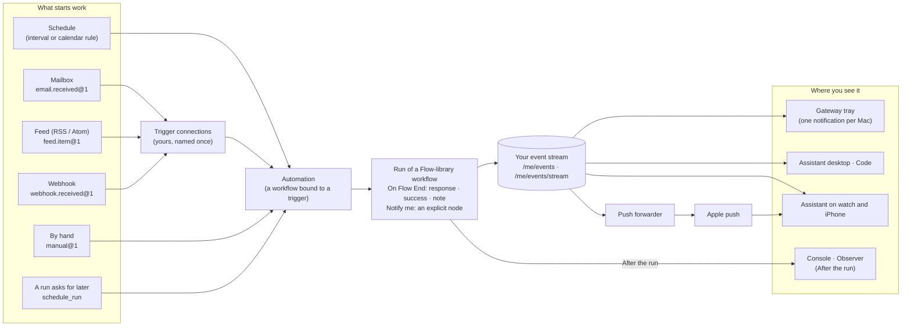

# Triggers, attention and push

How work starts on its own, how the framework tells you when something needs you, and how that
reaches every device you use: trigger connections, your event stream, notifications on the Mac,
the watch and the iPhone, and what a flow may do once it ends.

> **Availability: the next release, not yet published.** Everything on this page ships with
> AbstractRuntime 0.12.0, AbstractGateway 0.16.0, AbstractFlow 0.11.0, AbstractObserver,
> AbstractAssistant 0.15.0 (desktop) and 0.16.0 (iPhone and Apple Watch), and AbstractCode 0.11.0
> (web 0.12.0);
> those versions are built and tested locally and are not on PyPI or npm yet. The published
> releases run the automations described in [Automations](automations.md): schedules (fixed
> intervals, and daily, weekly or monthly rules in a time zone), new mail in your own mailbox and
> **Run now**. The release order is in the [changelog](../CHANGELOG.md#unreleased).

The package pages hold the full references:

| Topic | Reference |
|---|---|
| Trigger sources, connections, the CloudEvents envelope, `schedule_run` | [AbstractRuntime: Automations](https://github.com/lpalbou/AbstractRuntime/blob/main/docs/automations.md) |
| The Triggers, event-stream, push and After-the-run routes | [AbstractGateway: API](https://github.com/lpalbou/AbstractGateway/blob/main/docs/api.md#triggers) |
| Worked examples (a mailbox judge, a feed digest, a webhook) | [AbstractGateway: Events and triggers examples](https://github.com/lpalbou/AbstractGateway/blob/main/docs/events-examples.md) |
| Push to the watch and the iPhone, running your own forwarder | [AbstractGateway: Push](https://github.com/lpalbou/AbstractGateway/blob/main/docs/push.md) |
| The apps on the watch and the iPhone | [AbstractAssistant for iPhone](https://github.com/lpalbou/AbstractAssistant/blob/main/phone/iphone/README.md), [for Apple Watch](https://github.com/lpalbou/AbstractAssistant/blob/main/watch/apple/README.md) |

## The picture

## Triggers and connections

An automation runs a workflow on a trigger. Besides schedules, new mail and **Run now**, a trigger
can be a **connection**: one instance of a source that needs your settings, registered once on the
gateway console's **Triggers** page and reused by name.

- **A mailbox** (`email.received@1`): several mailboxes per person, each connected with a password
  or with Google or Microsoft sign-in, servers found from the address. Each mailbox's access is
  your choice: **Read only** (the default) or **Read and write** (changes such as mark, label, move
  and delete, and sending, which also needs the outgoing server).
- **A feed** (`feed.item@1`): an RSS 1.0, RSS 2.0 or Atom feed, polled by the gateway (every 15
  minutes by default). New connection → Feed starts from a catalogue of well-known open feeds.
- **A webhook** (`webhook.received@1`): a signed endpoint for an external system; its signing
  secret is shown once.

A connection is fetched only while an automation uses it. Each event reaches the workflow in the
CloudEvents shape (`type`, `subject`, `time`, `data`), as untrusted content. An agent can also ask
for work later in its own session with `schedule_run`: a reminder that runs with at most the
agent's own tools and notifies you by default.

In AbstractFlow, **+** asks what starts a new flow; a triggered flow opens with its typed start and
end pins, **Run as if triggered** runs it on real sampled data, and **Turn it on** binds it to the
trigger. The Mail nodes (search, get, mark, flag, label, move, delete, send, reply, forward,
attachment) handle mail deterministically, without a model.

A folder on this computer as a trigger, and cloud drives, are planned
([backlog 1052](backlog/planned/1052_folder_trigger_files_as_typed_records.md),
[1053](backlog/proposed/1053_cloud_drive_triggers_google_drive_dropbox.md)), not built.

## Your event stream

Every person has one ordered stream on the gateway: runs that started and finished, trigger
events, wakes, attention items (an approval or a question a run waits on, an automation's result or
failure, an alert a flow published), and each notification a device showed. A client catches up
with `GET /api/gateway/me/events?after=<sequence>` and stays live with
`GET /api/gateway/me/events/stream`. What needs you is every `attention.raised` without its
`attention.seen`, so a wait answered on one device disappears from all of them.

The gateway tray, the Assistant (desktop, watch and iPhone) and AbstractCode follow the stream;
the console lists your attention items. On one Mac you get one notification per item: the tray notifies
first and the apps stay silent for what it already showed. Every device records what it showed
(`notification.sent`), so your other devices can tell.

## Push to the watch and the iPhone

When something needs you and the Assistant app is closed, the gateway sends an Apple push through a
**push forwarder**. For you there is nothing to configure: sign in to the app and allow
notifications; the app registers itself with your gateway. The push carries no content: the app's
notification extension reads the event from your own gateway and shows "Approval needed", "A
question for you", "<automation> has a result" or failed, or the title of an alert. A watch that
registered in the last 24 hours takes the alert, otherwise the iPhone does, so your wrist rings
once.

Apple delivers only pushes signed with the app publisher's key, so the forwarder is the
publisher's service or one you run yourself with your own Apple key (`abstractgateway push-relay`).
The gateway has one admin setting for it, **Push forwarder** in the console (My email →
Notifications): Built-in, Off, or Your own forwarder. The built-in forwarder is not live yet: until
it is, pushes stay off unless you set your own, and the apps catch up when they open.

## What a flow does once it ends

Two decisions govern every workflow that runs for a person:

- **Critical workflows live in the Flow library**
  ([ADR-0040](adr/0040-critical-workflows-live-in-the-flow-library.md)). Anything an automation,
  a trigger or an app runs is a visual flow you can open, read and change in AbstractFlow. Agents
  may draft a flow there for review; only you publish it. The library sorts flows by what starts
  them: **Chat**, **Triggered** and **Other** (schedules are set in the Observer and the Assistant).
- **No hidden effects after a flow** ([ADR-0041](adr/0041-no-hidden-effects-after-a-flow.md)).
  On Flow End records the outcome (`response`, `success`, `note`); everything that reaches you is
  a node on the canvas, **Notify me** (whom it reaches and on which channels: tray, watch, phone,
  email, console) or **Publish to channel** with Alert on. Older flows keep their `notify` pin as
  a labelled compatibility path. Every run answers **After the run**
  (`GET /api/gateway/runs/{run_id}/after`, shown in Flow and the Observer): what arrived, the
  note, every alert raised, each delivery with its channel and device, or why nothing rang.

## A responsive gateway under load

The gateway stays responsive with tens of thousands of runs: run listings come from an in-memory
index (shadow-checked by default, `serve --run-index`), blocking work runs in bounded pools by
kind, account services are built off the event loop, and the garbage collector is tuned after boot
(`--gc-tuning`). A load test in AbstractGateway's CI boots a hermetic gateway on 10,000 runs and
100,000 artifacts and fails when a route's p99 or the CPU at rest exceeds its bound. Running the
API and the runs in two processes is available as an opt-in (`abstractgateway runner` beside
`abstractgateway serve --no-runner`); see
[AbstractGateway: Configuration](https://github.com/lpalbou/AbstractGateway/blob/main/docs/configuration.md#split-mode-api-and-runner-in-two-processes-opt-in).

## Related

- [Automations](automations.md): the automation model, creating and managing automations.
- [Architecture](architecture.md#events-attention-and-push): where these pieces sit in the stack.
- [Glossary](glossary.md#events-and-attention): trigger connection, event stream, attention item,
  push forwarder, Notify me, After the run.
- [FAQ](faq.md#how-do-notifications-reach-my-watch-and-iphone).
